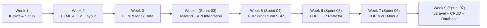
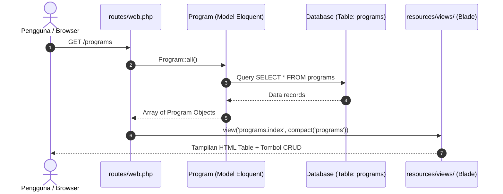

# BookTrack & PresidentKu 📚🏛️ — Web Programming Iteration (Week 1 — Week 9)

Aplikasi web modern yang dikembangkan secara berkelanjutan dari **Week 1 hingga Week 9** (Sprint 01 hingga Sprint 07), bertransformasi dari **Client-Side Web (HTML/JS/API/Tailwind)**, ke **Server-Side PHP Prosedural**, **Object-Oriented PHP (OOP)**, **Arsitektur MVC Manual**, hingga **Framework Laravel + Database + CRUD (Eloquent ORM)**.

---

## 👥 Tim Pengembang (Kelompok 2 Orang)

* **Kontributor 1 (Member A):** Erlinrsa *(Product, Models & Database)*
* **Kontributor 2 (Member B):** Arsyad Alhakim *(UI/UX, Views & Routing)*

---

## 🗺️ Perkembangan Materi & Iterasi (Week 1 — Week 9)



| Pekan | Sprint | Tema / Materi Pembahasan | Kontributor | File Utama |
| :---: | :---: | :--- | :---: | :--- |
| **Week 1** | Kickoff | Project Kickoff, Problem Statement & Git Setup | Erlinrsa | `README.md` |
| **Week 2** | Sprint 01 | Semantic HTML Layout & Typography Styling | Arsyad Alhakim | `index.html`, `css/styles.css` |
| **Week 3** | Sprint 02 | Interactive DOM Manipulation & Local State | Erlinrsa | `js/data.js`, `js/app.js` |
| **Week 4** | Sprint 03 | Client-Side Web with Tailwind CSS & Live API Integration | Arsyad Alhakim | `js/api.js`, `index.html` |
| **Week 5** | Sprint 04 | Server-Side PHP Procedural SSR & Dynamic Cards | Erlinrsa | `index_week5_procedural.php` |
| **Week 6** | Sprint 05 | Object-Oriented PHP (Class, Object, Encapsulation) | Arsyad Alhakim | `index_week6_oop.php` |
| **Week 7** | Sprint 06 | Arsitektur MVC Manual (Model, View, Controller) | Erlinrsa & Arsyad | `models/`, `controllers/`, `views/`, `index_week7_mvc.php` |
| **Week 9** | **Sprint 07** | **Laravel Framework + CRUD + Database (Eloquent ORM)** | **Erlinrsa & Arsyad** | `app/`, `database/`, `resources/`, `routes/web.php`, `artisan` |

---

## 🚀 Fitur Week 9 (Sprint 07): Laravel + CRUD + Database

Sesuai modul **Pertemuan 9: Web Programming (Slide 1 — 16)**, data program kini dikelola secara dinamis dan persisten melalui database menggunakan **Laravel Eloquent ORM**:



### 1. Task 01: Create Database Structure (Migration)
* File migration: `database/migrations/2026_11_16_000000_create_programs_table.php`
* Struktur tabel `programs`:
  - `id`: Primary key auto-increment
  - `nama`: String nama program prioritas
  - `deskripsi`: Text penjelasan ruang lingkup program
  - `created_at` & `updated_at`: Timestamps

### 2. Task 02: Build Program Model (Eloquent ORM)
* File model: `app/Models/Program.php`
* Properti `$fillable = ['nama', 'deskripsi']` untuk mencegah mass-assignment vulnerability.
* Pengujian Eloquent melalui route `GET /test-eloquent`:
  - `Program::all()` &rarr; mengambil semua data dari database.
  - `Program::find(1)` &rarr; mengambil data spesifik berdasarkan ID.
  - `Program::create([...])` &rarr; menyimpan data baru.

### 3. Task 03: Build Program CRUD
* **CREATE (`/programs/create` & `POST /programs`):** Form tambah data yang tersimpan persisten ke database.
* **READ (`/programs`):** Menampilkan daftar data program dalam tabel responsif dari database tanpa hard-code.
* **UPDATE (`/programs/{id}/edit` & `POST /programs/{id}/update`):** Form edit yang memperbarui data program yang sudah ada.
* **DELETE (`POST /programs/{id}/delete`):** Modal konfirmasi hapus data dari database.

---

## 💻 Cara Menjalankan Aplikasi

### Menjalankan Laravel Server (Week 9 — Rekomendasi Utama)
Buka terminal di folder project `Book Track` lalu jalankan:

```bash
# 1. Jalankan migrasi dan seeder awal (hanya sekali)
php artisan migrate
php artisan db:seed

# 2. Jalankan server Laravel
php artisan serve
```
Buka browser di alamat:
👉 **`http://localhost:8000/programs`**

#### Endpoint yang Dapat Diakses:
* **Halaman CRUD Utama:** `http://localhost:8000/programs`
* **Form Tambah Data:** `http://localhost:8000/programs/create`
* **Uji Eloquent JSON (Slide 11):** `http://localhost:8000/test-eloquent`
* **Versi Week 7 (Manual MVC):** `http://localhost:8000/index_week7_mvc.php`
* **Versi Week 6 (OOP PHP):** `http://localhost:8000/index_week6_oop.php`
* **Versi Week 5 (PHP Prosedural):** `http://localhost:8000/index_week5_procedural.php`
* **Versi Week 4 (Client-Side API):** `http://localhost:8000/index.html`

---

## 📁 Struktur Berkas Laravel (Week 9)

```
Book Track/
├── app/
│   ├── Models/
│   │   ├── Program.php             # Eloquent Model Program (Sprint 07)
│   │   └── Book.php                # Eloquent Model Book
│   └── Core/
│       └── Engine.php              # Runtime Engine Laravel-Compatible
├── database/
│   ├── migrations/
│   │   ├── 2026_11_16_000000_create_programs_table.php
│   │   └── 2026_11_16_000001_create_books_table.php
│   ├── seeders/
│   │   ├── ProgramSeeder.php       # Data awal 4 program prioritas (Slide 13)
│   │   └── DatabaseSeeder.php
│   └── database.json / database.sqlite # Database penyimpanan
├── resources/
│   └── views/
│       ├── layouts/
│       │   └── app.blade.php       # Template layout utama Tailwind CSS
│       └── programs/
│           ├── index.blade.php     # Tampilan READ & modal DELETE (Slide 12)
│           ├── create.blade.php    # Form CREATE program (Slide 12)
│           └── edit.blade.php      # Form UPDATE program (Slide 12)
├── routes/
│   └── web.php                     # Definisi route CRUD & test-eloquent (Slide 3)
├── config/
│   └── database.php                # Konfigurasi database SQLite/MySQL
├── artisan                         # CLI Laravel (migrate, db:seed, serve, route:list)
├── .env & .env.example             # Konfigurasi environment database
├── composer.json                   # Definisi paket project Laravel
├── index.php                       # Web entry point
├── index_week7_mvc.php             # Arsip Week 7 (MVC Manual)
├── index_week6_oop.php             # Arsip Week 6 (OOP)
├── index_week5_procedural.php      # Arsip Week 5 (Prosedural)
└── index.html                      # Arsip Week 4 (Client-Side)
```

---

## 📝 Kunci Jawaban Refleksi & Demo Dosen (Slide 14 & 15)

1. **Apa fungsi Migration?**  
   *Migration adalah cara Laravel mendefinisikan dan mengelola version control struktur tabel database melalui kode (skema tabel, tipe data kolom, timestamps) tanpa perlu mengetik SQL manual di phpMyAdmin.*
2. **Apa fungsi Model?**  
   *Model adalah representasi struktur data tabel database dalam bentuk Class PHP, bertindak sebagai penghubung logika bisnis aplikasi dengan data.*
3. **Apa fungsi Eloquent ORM?**  
   *Eloquent adalah Object-Relational Mapper bawaan Laravel yang memungkinkan developer mengelola data database (query, insert, update, delete) menggunakan sintaks objek yang bersih dan mudah dibaca tanpa menulis raw SQL queries.*
4. **Apa perbedaan `Program::all()` dan `Program::find(1)`?**  
   *`Program::all()` mengembalikan kumpulan seluruh data (*Collection / Array of Objects*), sedangkan `Program::find(1)` mengembalikan tepat satu objek data tunggal yang memiliki `id = 1`.*
5. **Apa yang dimaksud CRUD?**  
   *CRUD adalah singkatan dari **Create** (menambah data baru), **Read** (mengambil dan menampilkan data), **Update** (mengubah data yang ada), dan **Delete** (menghapus data dari database).*
