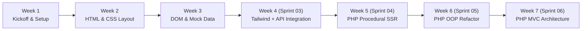
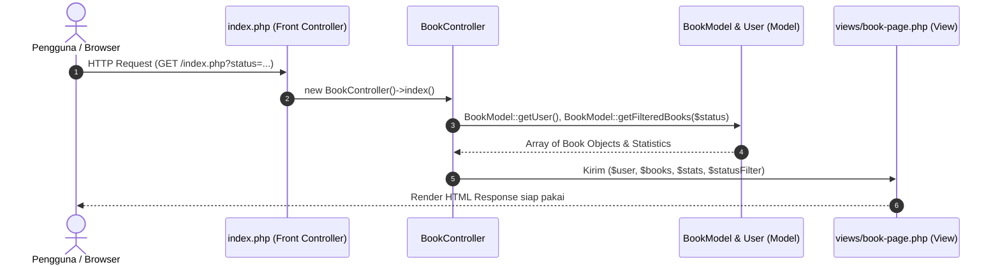

# BookTrack 📚 — Pelacak Buku & Program Prioritas Bacaan

Aplikasi web pelacak buku dan kebiasaan membaca modern yang dibangun dan dikembangkan secara iteratif dari **Week 1 hingga Week 7**, mencakup implementasi **Client-Side Web (Vanilla JS + API + Tailwind CSS)** hingga arsitektur server-side **PHP Prosedural**, **Object-Oriented Programming (OOP)**, dan **Model-View-Controller (MVC)**.

---

## 👥 Tim Pengembang (Kelompok 2 Orang)

* **Kontributor 1 (Member A):** Eko Felix *(Product & Core Logic)*
* **Kontributor 2 (Member B):** Partner Tim *(UI/UX & Integration)*

---

## 🗺️ Perjalanan Iterasi Proyek (Week 1 — Week 7)



| Minggu | Sprint | Tema / Materi Pembahasan | Kontributor | File Utama |
| :--- | :--- | :--- | :--- | :--- |
| **Week 1** | Kickoff | Project Kickoff, Problem Statement & Git Setup | Member A | `README.md` |
| **Week 2** | Sprint 01 | Semantic HTML Layout & Custom CSS Typography | Member B | `index.html`, `css/styles.css` |
| **Week 3** | Sprint 02 | Interactive DOM Manipulation & Local Storage State | Member A | `js/data.js`, `js/app.js` |
| **Week 4** | Sprint 03 | Client-Side Web with Tailwind CSS & Live API Integration | Member B | `js/api.js`, `index.html` |
| **Week 5** | Sprint 04 | Server-Side PHP Procedural Rendering & SSR Grid Cards | Member A | `index_week5_procedural.php` |
| **Week 6** | Sprint 05 | Object-Oriented PHP (Class, Object, Constructor, Encapsulation) | Member B | `index_week6_oop.php` |
| **Week 7** | Sprint 06 | Arsitektur MVC (Model - View - Controller Separation) | Member A & B | `models/`, `controllers/`, `views/`, `index.php` |

---

## 🏛️ Arsitektur MVC (Sprint 06 / Week 7)

Sesuai materi Pertemuan 7, aplikasi dipisahkan secara modular ke dalam 3 komponen utama:



### 1. Model (`models/`)
* **`User.php`**: Blueprint data profil pengguna (`name`, `role`, `yearlyTarget`, encapsulation private properties, public getters, greeting generator).
* **`Book.php`**: Blueprint objek buku (`title`, `author`, `totalPages`, `currentPage`, `status`, `rating`, `gradient`, method persentase progres, badge status, bintang rating).
* **`BookModel.php`**: Data Access Layer & Business Data aggregations (mengelola kumpulan buku, filter request, total buku, total halaman terbaca, rating rata-rata).

### 2. Controller (`controllers/`)
* **`BookController.php`**: Menerima input/request query pengguna (`$_GET['status']`), memanggil method pada `BookModel`, mengagregasi data, dan me-render template view.

### 3. View (`views/`)
* **`book-page.php`**: Berkas presentasi murni berbasis Tailwind CSS tanpa logika bisnis. Bertanggung jawab mencetak data yang disuplai oleh Controller ke antarmuka pengguna.

### 4. Front Controller (`index.php`)
* Titik masuk aplikasi (entry point) yang memuat semua dependensi dan mendelegasikan pemrosesan ke Controller.

---

## 🚀 Cara Menjalankan Aplikasi

### Versi Server-Side MVC (Week 7 — Rekomendasi Utama)
Pastikan PHP telah terpasang di komputer Anda. Buka terminal di folder project dan jalankan:
```bash
php -S localhost:8000
```
Buka browser di alamat:
👉 **`http://localhost:8000/index.php`**

Untuk menguji fitur *Request Handling* Controller:
* Tampilkan semua buku: `http://localhost:8000/index.php?status=all`
* Tampilkan buku yang sedang dibaca: `http://localhost:8000/index.php?status=Sedang dibaca`
* Tampilkan buku yang sudah selesai: `http://localhost:8000/index.php?status=Selesai`

### Versi Client-Side API (Week 4)
Buka file `index.html` langsung di browser atau via Live Server VS Code:
👉 **`http://localhost:8000/index.html`**

---

## 📁 Struktur Direktori Lengkap

```
Book Track/
├── controllers/
│   └── BookController.php          # Controller penanganan alur & request
├── models/
│   ├── Book.php                    # Model entitas buku (Encapsulation)
│   ├── BookModel.php               # Model data access & kalkulasi bisnis
│   └── User.php                    # Model entitas profil pengguna
├── views/
│   └── book-page.php               # Template view presentasi antarmuka
├── css/
│   └── styles.css                  # Custom styling & font
├── js/
│   ├── api.js                      # API Google Books & Quotable (W4)
│   ├── app.js                      # State management client-side (W4)
│   └── data.js                     # Seed data client-side (W4)
├── index.html                      # Single Page Application Client-Side (W4)
├── index.php                       # Front Controller MVC Entry Point (W7)
├── index_week5_procedural.php      # Arsip versi PHP Prosedural (W5)
├── index_week6_oop.php             # Arsip versi PHP OOP (W6)
└── README.md                       # Dokumentasi resmi proyek
```
